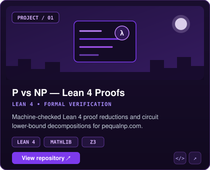
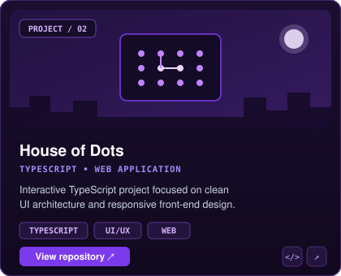

  

---

### ✦ About Me

I'm **Jaysheel Vijay** (`@redchief`), a builder and systems engineer working across **low-level Linux systems, formal verification, and full-stack software**.

I enjoy digging deep into how things work under the hood—from **Wayland compositors and mobile Linux stacks** (Mechanix OS) to **machine-checked Lean 4 proofs and circuit lower bounds** for the public [`P vs NP`](https://pequalnp.com/a/redchief) effort.

Outside systems and proofs, I build practical tools and interactive web applications across TypeScript, Python, Rust, and C/C++.

---

### 🛠️ Tech Stack

#### Languages & Systems

  

`Systems & Proofs:` `Lean 4` · `C` · `C++` · `Rust`  
`Apps & Scripting:` `TypeScript` · `JavaScript` · `Python` · `Swift` · `Dart`

#### IDEs & Developer Tools

  

`VS Code` · `Lean / Lake` · `Z3 SMT` · `Linux / Wayland` · `Git` · `GitHub`

#### Technical Foundations
`Formal Verification` · `Circuit Lower Bounds` · `Wayland Compositors` · `Linux Kernel` · `SAT / SMT Solving` · `Full-Stack Web`

---

### 📁 Featured Projects

<table>
  <tr>
    <td width="50%" align="center">
      
    </td>
    <td width="50%" align="center">
      
    </td>
  </tr>
</table>

  
✦ <strong>P vs NP — Lean 4 Proofs</strong> — Features &amp; technical highlights

   
  <ul>
    <li>Machine-checked Lean 4 proof reductions and circuit lower-bound decompositions submitted to <code>open-goat/pequalnp-proofs</code>.</li>
    <li>Verified strictly against the pinned Mathlib4 environment and kernel axioms via <code>check-lean.mjs</code> and <code>lake</code>.</li>
    <li>Combined with Z3 SMT synthesis to search and refute small-circuit bounds on promise graphs.</li>
  </ul>

  
✦ <strong>House of Dots</strong> — Features &amp; technical highlights

   
  <ul>
    <li>Built in TypeScript with clean component structure and interactive UI state management.</li>
    <li>Focused on responsive front-end design and maintainable, modular application architecture.</li>
  </ul>

---

### 🔭 Currently Exploring

- **Mobile Linux & Wayland**: `mechanix-comp`, `mecha-wayland`, and custom Linux kernel tooling for handheld devices.
- **Formal Methods & Complexity**: Scaling Lean 4 decomposition strategies and automated SAT/SMT proof search on `pequalnp.com`.
